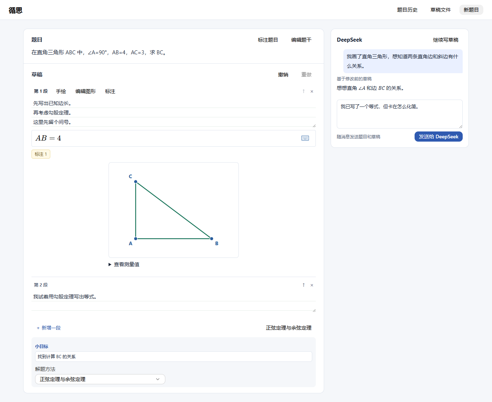

# 循思 · DeepSeek Harness 数学草稿本

循思是 [DeepSeek Harness](https://github.com/deepseek-ai/deepseek-harness) 的数学辅导插件。学生可以在左侧写公式、手绘和作图，卡住时标出疑问，和右侧的 DeepSeek 讨论下一步。草稿和讨论按题保存在当前浏览器。



## 安装

需要 Node.js 22.19 或更新版本。以下命令使用已验证的 Harness `0.2.2-rc.1` 和 `web` 配置。

1. 下载最新版本的 `dsh-socratic-tutor-*.tgz`。 [GitHub Releases](https://github.com/shuimo233/dsh-socratic-tutor/releases)
2. 在下载目录运行以下命令。使用其他版本时，把文件名替换为实际下载的文件名。

   ```sh
   npx @deepseek-ai/dsh@0.2.2-rc.1 plugin --profile web add ./dsh-socratic-tutor-0.2.35.tgz
   npx @deepseek-ai/dsh@0.2.2-rc.1 --profile web
   ```

3. 打开终端提供的本地地址，点击左侧栏「循思」。讨论与 AI 出题复用 Harness 当前连接的模型，手写识别需要支持图片输入的模型，联网搜题需要已配置网页搜索。

卸载时运行 `npx @deepseek-ai/dsh@0.2.2-rc.1 plugin --profile web remove dsh-socratic-tutor`，然后重新启动 Harness。

## 一次完整操作

1. 在题目区粘贴或输入题干，点击「完成编辑」查看排版。也可以点「找题」，按知识点、难度或题型生成题目，或打开搜索来源核对并粘贴题干。
2. 在「我的草稿」里自由换行，记算式、推导或疑问。需要排版公式时再点击「公式」，也可以打开「手绘」写几行算式或画草图。
3. 按顺序添加步骤，必要时上移或删除。点击步骤编号，或直接编辑那一行，可以切换当前步骤。
4. 卡住时，点右侧「聊聊卡点」，写下自己的尝试和疑问，再点「发送给 DeepSeek」。也可以在题干或草稿中选中相关内容并点击「标注」，围绕选中的内容聊。
5. DeepSeek 会看到题目、各段草稿和已应用的图形，回复会显示在右侧。支持图片输入的模型还可以看手绘草稿。可以试过建议后，写下新的发现继续聊。「辅导选项」可以选择想尝试的解题方法。
6. 辅导回复直接显示在当前步骤的辅导区，公式按数学格式排版。切换步骤可以回看该步骤最近保留的回复。
7. 在原公式行继续修改，或者添加下一步，再针对新卡点求助。草稿修改后，旧回复会注明它基于修改前的草稿。

导师通过 Harness 的原生模型接口直接调用当前选择的模型。题干、当前步骤和此前推导用于本次辅导。聊天输入框里的草稿和附件可以照常保留。

「自定义出题提示词」可以补充小问数量、解法限制等偏好，保存在当前浏览器。出题只提交练习需求和该偏好，搜索只提交练习需求。联网搜题需要在 Harness 的「网页搜索和抓取」中配置插件可用的搜索凭据。独立预览可编辑草稿，辅导、出题和搜索在 Harness 内使用。

## 坐标作图

识别到支持的几何题型后，当前步骤的工具栏会出现「作图」。题干只有公式或未匹配题型时，也可在「辅导选项」里手动打开。画板用 SVG 实时更新。

- 标准位置的椭圆、双曲线和抛物线可与直线联动。直线和曲线有两个交点时，画板标出 A、B、弦中点 P，并给出弦长的近似值。
- 三角形和四边形支持输入顶点坐标，查看边长、内角和面积。圆支持输入圆心、半径和两个圆周点的方位角，查看弦长和圆心角。

点击「应用到本步」保存图形并收起参数。后续步骤会沿用最近一张图，也可以应用新图。求助时，模型收到的是所用图形的方程、点坐标和弦长等数据，可以引用图中的对象讲解。数值对应当前参数，适合观察和核对。

## 手写识别：直接复用 DSH 的 DeepSeek 模型

1. 选中要填写的段落，点击「手绘」。
2. 用鼠标、手指或触控笔在画布上书写。可以撤销、恢复、清空笔画。点「完成手绘」后，草稿里会显示可重新打开的预览。
3. 如果希望转录，展开「转成可编辑公式」，尽量每次只写一个公式，然后点击「识别公式」。插件会裁剪空白，将 PNG 保存为 DSH 附件，通过 DSH 原生 `ctx.llm` 调用已有的模型连接和鉴权。
4. 先检查识别后的可编辑公式，必要时修正。模型认为有歧义时会标出说明。
5. 选择「填入当前步骤」「替换当前公式」或「插入为新步骤」。已经修改过的公式不会被旧识别结果覆盖。

默认跟随当前会话中支持图片的模型；否则优先使用已连接的 `deepseek-flash`。它原生支持图片输入，参见 [DeepSeek 图像理解文档](https://api-docs.deepseek.com/zh-cn/guides/vision/)。无需再为插件配置一套 OCR 账号或 API Key。手写面板中的模型列表来自 DSH，仅用于选择已有连接。

只在主动点击「识别公式」时发送手写 PNG；绘制过程中不发送。笔迹按浏览器、会话和步骤分别保存在本机；提交识别后，PNG 同时进入 DSH 的附件存储。可下载图片备份。切换步骤会关闭当前面板；重新打开可以恢复该步骤笔迹。

如果 DSH 本身尚未配置任何可用模型，面板会保留笔迹并提示完成 DSH 的模型登录或 API Key 配置。插件不会生成假识别结果。独立预览没有 DSH 模型连接，可体验手写、撤销、保存和下载图片。

## 卡点讨论

- 学生先写自己的想法或疑问。DeepSeek 结合草稿给出一个可以亲自验证的下一步，或先追问一个具体细节。
- 「解题方法」跟随当前步骤保存。DeepSeek 会判断学生选择的方法是否适合当前卡点。
- 追问会带上上一轮消息和回复，讨论区保留多轮记录。发送失败或取消时，输入框保留学生写的话。
- 发送后可以继续写草稿。回复基于发送时的文字和图形，期间改过文字草稿时会有标记。

本插件内置的教学规则根据本次对话中的流程重新实现；没有读取或复用原对话附件里的 `socratic-tutor-skill-v0.1.zip`。

## 保存和备份

- 题目、公式、手绘、说明和辅导记录按题目保存在当前浏览器。刷新、重新打开循思或切换 Harness 聊天时，会恢复上次打开的题目。
- 「新题目」会保留当前草稿。用「题目历史」打开之前保存的题目，也能找到同一浏览器中仍保留的旧版会话草稿。撤销和重做记录在当前编辑期间有效。
- 切换浏览器、设备或访问地址不共享草稿。清理站点数据会删除本机草稿。
- 「导出」下载当前题目的 JSON 草稿；「导入」校验版本、大小和数据结构后，把它作为独立题目打开。
- 无法读取旧数据时暂停自动保存，直到手动确认使用当前草稿重新保存；写入失败会显示提示。
- 建议长时间学习后导出备份。最多 40 个步骤，整个题目与推导最多 24,000 字符。

## 已有能力与当前限制

题目、公式和图形通过 Harness 选中的模型辅导。数学判断来自模型回复，学生可以结合题设检验建议。手写识别需要视觉模型，确认识别结果后可插入公式块。

## 开发与验证

```sh
git clone https://github.com/shuimo233/dsh-socratic-tutor.git
cd dsh-socratic-tutor
npm ci
npm run build
npm run preview
```

打开本地预览可体验手写、公式和草稿保存。模型功能在 Harness 内使用。开发时可运行 `npm run pack:plugin`，然后按安装步骤将生成的 `.tgz` 装入测试配置。 [本地交互预览](http://127.0.0.1:4178)

```sh
npm run typecheck
npm test
npm run build
npm run test:ui
```

`test:ui` 自动启动临时本地预览服务，使用 Playwright 检查公式键盘输入、讨论的草稿上下文和后续追问、刷新恢复、撤销重做、无效导入和窄屏布局。可设置 `TUTOR_CHROME_PATH` 指向本机 Chromium；否则优先使用 Playwright 安装的浏览器。

`scripts/harness-smoke.mjs` 在本地 Harness 中创建测试草稿，使用所选模型获取一次辅导回复，并验证回复能内嵌显示、聊天输入框中的草稿得到保留。将本地地址放入 `TUTOR_HARNESS_URL` 环境变量后运行。可使用单独的 `DSH_HOME` 测试目录隔离配置和测试数据。

构建生成 `lib/` 和 `preview-dist/`，浏览器测试截图保存在 `artifacts/`，安装包文件名带有当前版本号。

## 代码入口

- `src/notebook.ts`：草稿结构、容量校验、提示策略、请求生成与保存。
- `src/client/notebook-view.tsx`：共享公式草稿本。
- `src/client/index.tsx`：Harness Slot 注册与聊天输入框适配。
- `src/client/math-field.tsx`：MathLive 编辑器适配。
- `src/client/handwriting-panel.tsx`：手写采集、笔画保存、识别确认和插入。
- `src/handwriting-server.ts`：DSH 图片附件与原生模型调用、鉴权、并发限制和超时。
- `scripts/build.mjs`：生成 Harness 模块工厂格式的客户端包，并内嵌字体。

## 官方接口参考

- [Harness 界面 Slot 扩展](https://deepseek-harness.github.io/deepseek-harness/en/reference/subsystems/slots)
- [Harness 客户端模块](https://github.com/deepseek-ai/deepseek-harness/blob/master/docs/subsystems/client-modules.md)
- [Harness 输入框接口](https://github.com/deepseek-ai/deepseek-harness/blob/master/packages/client/ui-conversation/src/client/contract/input.ts)
- [MathLive 编辑器](https://mathlive.io/mathfield/)

MathLive 采用 MIT 许可证，分发包保留其许可证于 `lib/MATHLIVE-LICENSE.txt`。

## 反馈

反馈时可以附上 Harness 版本、浏览器和复现步骤。 [GitHub Issues](https://github.com/shuimo233/dsh-socratic-tutor/issues)
